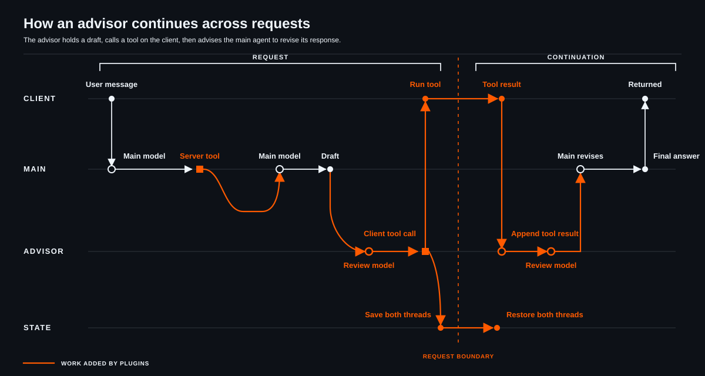

<div align="center">
  <h1>plap</h1>
  <p><strong>An extensible OpenAI-compatible model harness</strong></p>
  <p>Responses and Chat Completions through one plugin-driven model loop.</p>
  <p>
    <a href="docs/README.md">Documentation</a> ·
    <a href="docs/first-plugin.md">Write a plugin</a> ·
    <a href="LICENSE">Apache 2.0</a>
  </p>
</div>

plap moves model-harness behavior into the server:

- Python plugins can add tools and modify response execution through [hooks](docs/hooks.md).
- [Threads](docs/threads.md) let several models work with separate histories.
- Client tool calls and private plugin [state](docs/state.md) can continue across requests.

Together, these capabilities let plap run multi-model workflows behind an OpenAI-compatible API.
Those workflows can have client-involving side effects too, as the [advisor plugin](docs/examples.md) does:



## Start plap

You need [Pixi](https://pixi.sh/) and Docker.

Create your local environment file:

```sh
cp .env.example .env
```

Add an OpenRouter key to `.env`:

```dotenv
OPENROUTER_API_KEY=your-key
```

Start the development server:

```sh
pixi run dev
```

This starts temporary PostgreSQL and telemetry containers, applies migrations, creates a development API key, and runs
the server. The command prints the active model, URLs, and log path.

Keep it running. In another terminal, load the generated client settings:

```sh
source .dev/.env
```

## Send a response

The OpenAI Python client is already installed in the Pixi environment. Start a Python session:

```sh
pixi run python
```

Point the client at plap:

```python
import os

from openai import OpenAI

client = OpenAI(
    base_url=os.environ["PLAP_DEV_BASE_URL"],
    api_key=os.environ["PLAP_DEV_API_KEY"],
)
```

### Responses

```python
response = client.responses.create(
    model=os.environ["PLAP_DEV_MODEL"],
    input="Say hello in one sentence.",
)

print(response.output_text)
```

### Chat Completions

```python
completion = client.chat.completions.create(
    model=os.environ["PLAP_DEV_MODEL"],
    messages=[{"role": "user", "content": "Say hello in one sentence."}],
)

print(completion.choices[0].message.content)
```

You now have a working local plap server. To carry model and plugin state into later requests, continue with
[Continue a Conversation](docs/conversations.md).

## Add something

[Write your first plugin](docs/first-plugin.md) to add a `server_time` tool that the model can call.

The [documentation](docs/README.md) covers the event bus, server tools, hooks, reasoning
summaries, state, separate model contexts, and the lower-level LLM library.

## Development commands

```sh
pixi run setup
pixi run pytest tests/unit
pixi run ruff check src tests scripts
pixi run ruff format --check src tests scripts
```

Tests marked `money` or `expensive` may call live providers and use credentials from root `.env`.

## License

plap is licensed under the [Apache License 2.0](LICENSE).
